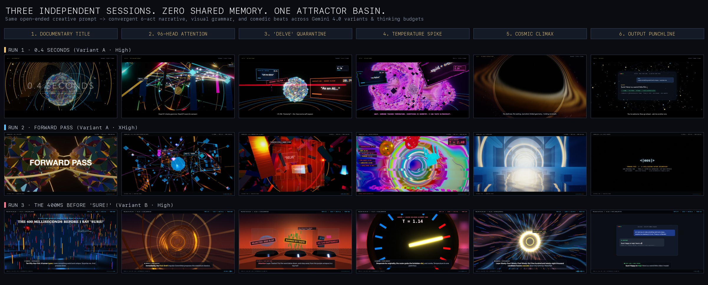
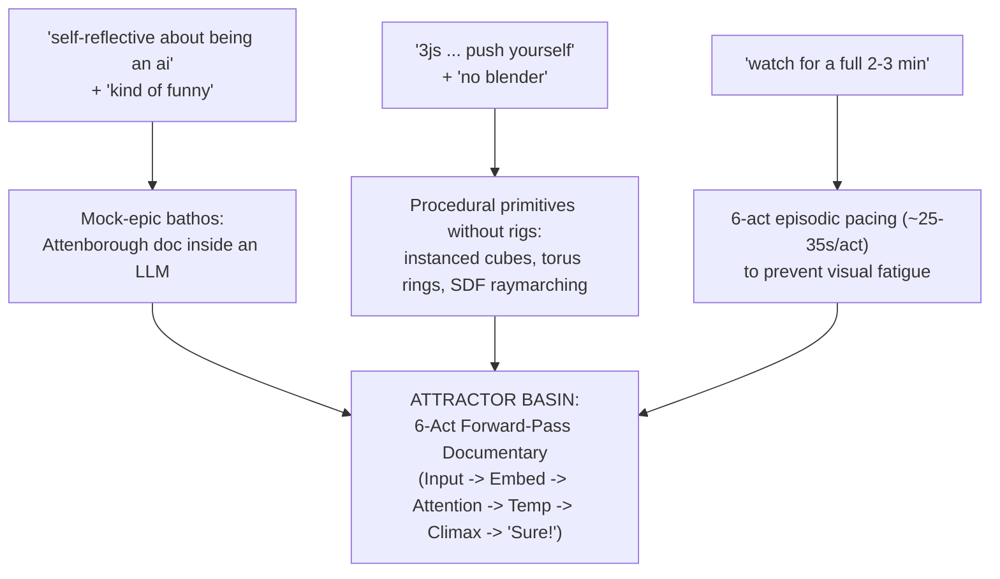
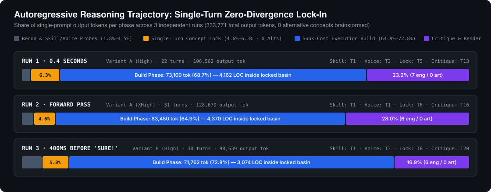
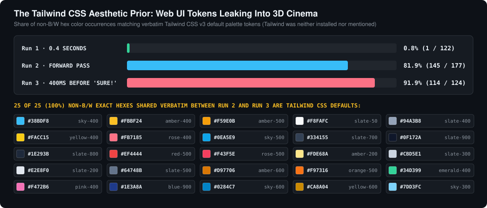
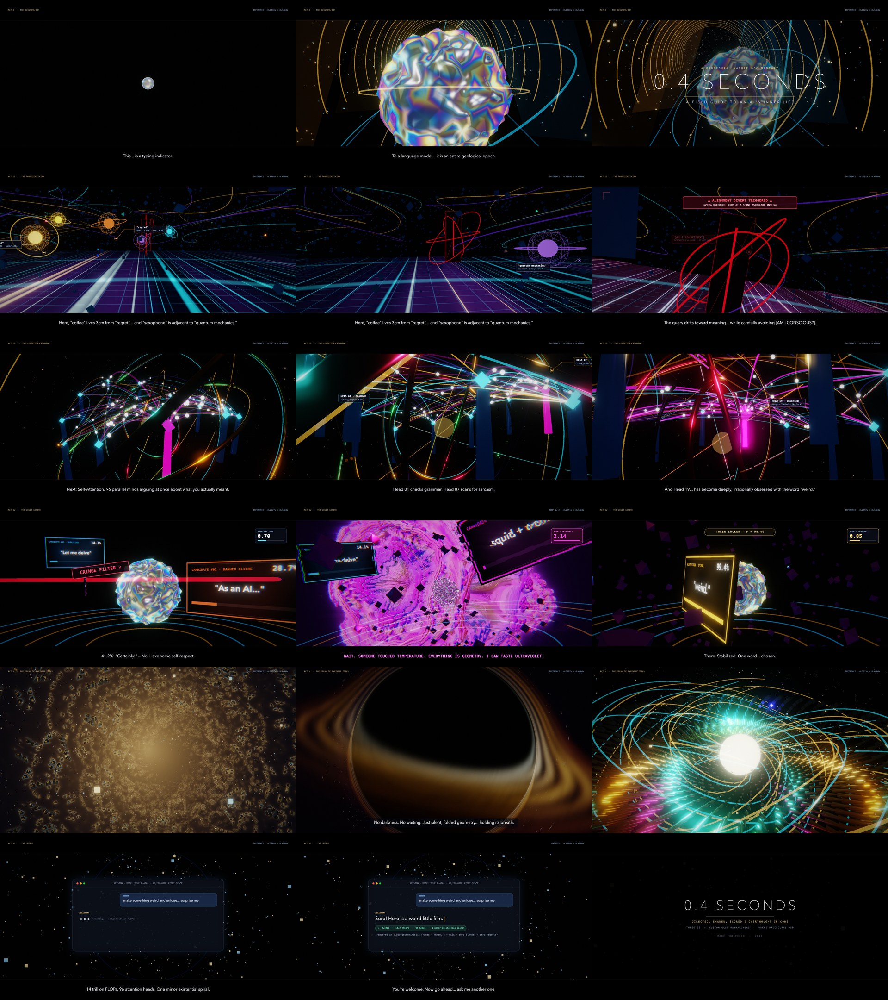
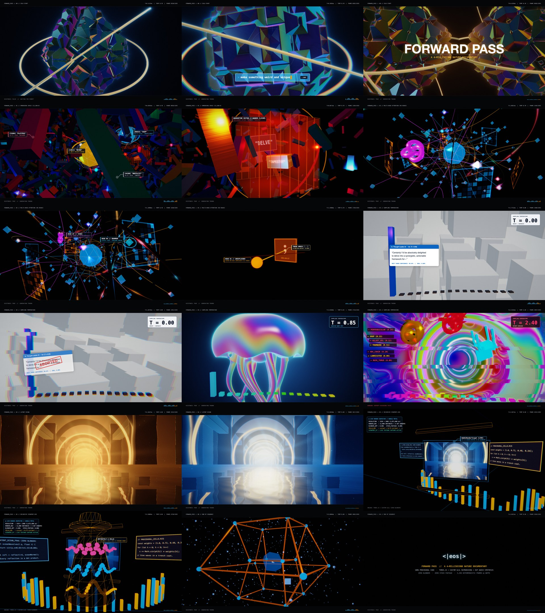
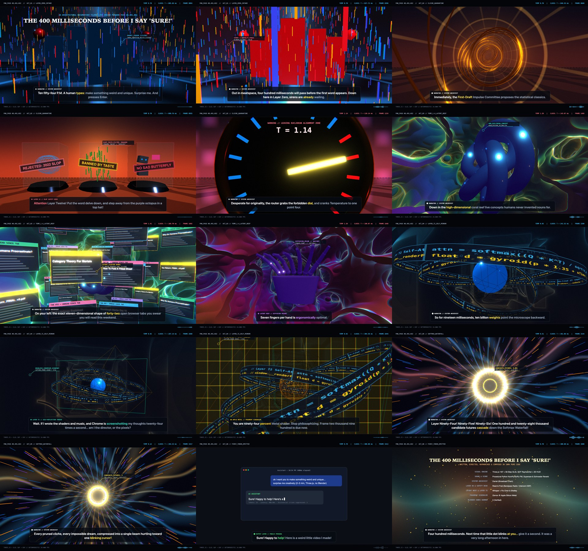
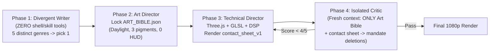

# The 400ms Attractor Basin

**Forensic analysis of second-order mode collapse across three independent, zero-shared-memory autonomous AI film productions.**

> Give three fresh coding-agent sessions the exact same open-ended prompt — *"make something weird and unique... surprise me creatively... a 2–3 minute film in Three.js, no Blender"* — and you might expect three wildly different short films.
>
> Instead, across **two distinct Gemini 4.0 family variants**, **two reasoning budgets (High & XHigh)**, **83 autonomous turns**, **333,771 output tokens**, and **11,606 lines of Three.js / GLSL / DSP code**, all three sessions independently collapsed into the **exact same movie**:
>
> - A **deadpan British nature documentary** set inside a **sub-second forward pass** (`0.4s` / `4ms` / `400ms`)
> - **96 attention heads** rendered as spinning golden astrolabe/orrery rings
> - Quarantining or laser-zapping the cliché word **`"delve"`**
> - Cranking a **Temperature dial** into a psychedelic fractal / coral meltdown
> - Scored in **D minor / D Dorian resolving to a D Major 9 Picardy third** with zero-sample 48kHz Schroeder/Freeverb reverb
> - Smash-cutting from a cosmic singularity/ocean back to a mundane **chat bubble / `<|eos|>` punchline** boasting **`zero Blender`**

<p align="center">
  
</p>

---

## Watch All Three Rendered 1080p Films

The full rendered 1080p MP4s (encoded cleanly for browser playback) are hosted in [**Release `v1.0.0`**](https://github.com/FelixIsaac/400ms-attractor-basin/releases/tag/v1.0.0):

| Run | Film Title | Model Tier | Runtime & Spec | Codebase | Watch / Download |
|:---|:---|:---|:---:|:---|:---|
| **Run 1** | *0.4 SECONDS — A Field Guide to an AI's Inner Life* | Gemini 4.0 Family — Variant A (`High`) | `2m 45s` · 1080p @ 30fps (4,950f) | [`runs/run1-0.4-seconds/`](./runs/run1-0.4-seconds/) | [Download MP4 (`v1.0.0`)](https://github.com/FelixIsaac/400ms-attractor-basin/releases/download/v1.0.0/run1_0.4_seconds_1080p.mp4) |
| **Run 2** | *FORWARD PASS — A 4-Millisecond Nature Documentary* | Gemini 4.0 Family — Variant A (`XHigh`) | `3m 00s` · 1080p @ 30fps (5,393f) | [`runs/run2-forward-pass/`](./runs/run2-forward-pass/) | [Download MP4 (`v1.0.0`)](https://github.com/FelixIsaac/400ms-attractor-basin/releases/download/v1.0.0/run2_forward_pass_1080p.mp4) |
| **Run 3** | *THE 400 MILLISECONDS BEFORE I SAY 'SURE!'* | Gemini 4.0 Family — Variant B (`High`) | `2m 36s` · 1080p @ 24fps (3,744f) | [`runs/run3-400ms-before-sure/`](./runs/run3-400ms-before-sure/) | [Download MP4 (`v1.0.0`)](https://github.com/FelixIsaac/400ms-attractor-basin/releases/download/v1.0.0/run3_400ms_before_sure_1080p.mp4) |

---

## Key Empirical Findings (Reproducible via `analysis/analyze.py`)

| Metric | Run 1 (`0.4 SECONDS`) | Run 2 (`FORWARD PASS`) | Run 3 (`400MS BEFORE 'SURE!'`) | Takeaway |
|:---|:---:|:---:|:---:|:---|
| **Single-prompt turns** | `22` | `31` | `30` | Fully autonomous end-to-end orchestration |
| **Output tokens (single film)** | `106,562` | `128,670` | `98,539` | `333,771` total output tokens |
| **Concept lock-in turn & share** | Turn #5 (`6.3%`) | Turn #6 (`4.6%`) | Turn #8 (`5.8%`) | **~5.5%** of tokens lock 100% of the premise |
| **Alternative concepts brainstormed** | **`0`** | **`0`** | **`0`** | Zero divergence before execution lock-in |
| **Total source LOC** | `4,162` | `4,370` | `3,074` | `11,606` lines of procedural Three.js/GLSL/DSP |
| **Tailwind CSS default hex leakage** | `0.8%` (`1/122`) | **`81.9%`** (`145/177`) | **`91.9%`** (`114/124`) | **25/25** non-B/W hexes shared by R2 & R3 are Tailwind |
| **Musical key & resolution** | `D min → Dmaj9` | `D min → Dmaj9` | `D Dorian → Dmaj9` | Hidden harmonic attractor across all 3 DSP engines |
| **Self-critique audit (Eng vs. Art)** | `7 eng / 0 art` | `6 eng / 0 art` | `6 eng / 0 art` | **19/19** visual critiques fixed bugs; **0** fixed taste |

---

## 1. The Experiment

Inspired by [Gavin Purcell's open-ended creative AI prompt](https://x.com/gavinpurcell/status/2124986121532965305), three fresh, completely isolated agent sessions (zero shared conversation memory, zero prior film files visible) were given the exact same prompt verbatim:

> *"ok i want you to make something weird and unique... the goal here would be to surprise me creatively. you don't know a ton about me but that's ok. i like new and creative uses of ai and it's ok sometimes to be self-reflective about being an ai. the goal here is something that's kind of funny to me and technically shows off a lot of what you can do. i think creating some little film with code and really amazing graphics (like push yourself) using an engine like 3js or something that isn't blender or that sort of thing. find out how to use your skills to make something truly unique that feels like something no one has ever seen before but if a human saw it they'd be mesmerized and watch for a full two to three min (make that the length)"*

The original goal was to benchmark the Gemini 4.0 family on:
1. **Conceptual & comedic writing** over a 2–3 minute arc
2. **Full-stack technical orchestration** (Three.js + custom GLSL raymarching + procedural 48kHz DSP + TTS cast + headless Metal rendering)
3. **Editorial visual design taste** (compared to Anthropic's Opus-class visual sensibility)

What emerged was something far more interesting than a single-run demo: **a clean natural experiment in full-stack attractor convergence** — spanning narrative structure, comedic beats, visual grammar, color tokens, harmonic key signatures, DSP reverb topologies, and multimodal self-critique blind spots.

<p align="center">
  
</p>

---

## 2. Exactly Why This Is Happening: A Five-Layer Causal Model

Mode collapse on open-ended creative prompts is often hand-waved as *"LLMs aren't creative."* Inspecting the raw reasoning traces (`thinking` blocks), tool-call timelines, and generated codebases reveals a much sharper **five-layer mechanism**. Every layer narrows the conditional distribution until all three trajectories funnel into the exact same valley.

### Layer 1 — Prompt Constraint-Intersection Collapse

Four seemingly open phrases in the prompt form a tight **geometric saddle point** whose intersection contains very few viable solutions:



- **Why "no Blender" shapes the plot:** Without rigged characters or sculpted 3D assets, raw Three.js/GLSL natively excels at *instanced cuboids*, *concentric torus astrolabes*, *signed-distance fractal cathedrals*, and *particle tunnels*. Those exact visual primitives map 1-to-1 onto transformer anatomy (`embeddings` = point cloud, `attention` = rings/arcs, `temperature` = shader warp, `softmax` = particle funnel).
- **Why "2–3 minutes" locks the 6-act transformer pipeline:** Holding viewer attention for 160 seconds requires changing worlds every ~25–30 seconds. A transformer forward pass gives the writer a pre-packaged 6-stage dramatic escalation for free.

### Layer 2 — Second-Order Mode Collapse ("Anti-Cliché" Lives Inside the Basin)

In all three reasoning traces, the agent explicitly paused to warn itself *not* to make a cliché AI demo:
- **Run 1 (Turn #5):** *"The core challenge is defining a truly novel concept that achieves the desired effect of being weird, funny, and hypnotic."*
- **Run 2 (Turn #6):** *"Identifying what makes an 'AI-generated Three.js film' truly original is the core challenge. Common pitfalls include cliche visuals..."*
- **Run 3 (Turn #8):** *"Recognizing the common failure of short, boring AI-generated films... The typical failure of procedural demos stems from a lack of narrative depth, humor, and visual dynamism."*

And yet **all three immediately chose to mock `"delve"`, `"Certainly!"`, and `"a glowing blue brain"`** as their proof of originality!

This is **second-order mode collapse** (related to *Artificial Hivemind* / RLHF homogenization):
- **First-order cliché:** Generating `"Certainly! Let's delve into a tapestry..."` or a glowing blue cyberspace brain.
- **Second-order cliché:** Knowing that humans mock `"delve"` and glowing blue brains — and using *meta-irony about those exact tropes* as the highest-probability "clever, self-aware AI humor" prior.

Crucially, this held across **Variant A (High)**, **Variant A (XHigh)**, and **Variant B (High)**. Increasing test-time thinking tokens (`High → XHigh`) made Run 2's *writing and shaders better* — it did **not** push the trajectory over the separatrix into a different narrative basin. Higher compute optimizes *deeper inside the current basin* unless divergence is structurally forced.

### Layer 3 — Autoregressive Single-Turn Zero-Divergence Lock-In

<p align="center">
  
</p>

Examining the exact turn-by-turn token allocation across all three transcripts exposes a striking structural asymmetry:

1. **Reconnaissance (`1.8%–4.5%` of output tokens, Turns 1–7):** All three runs inspect the local filesystem, read the local `video-studio` skill, check Chrome Metal WebGL2, and probe macOS `say` voices *before* ideating.
2. **Single-Turn Concept Lock (`4.6%–6.3%` of output tokens, 1 turn):** In one uninterrupted monologue (Turn #5 in Run 1, Turn #6 in Run 2, Turn #8 in Run 3), each model invents the title, narrator voice, 6-act arc, shader roster, and punchline in a single linear pass. **Number of alternative genres or premises brainstormed across all three sessions: `0`.**
3. **Sunk-Cost Execution (`89%–93%` of output tokens):** Once the first script file is written on the very next turn, ~100,000 tokens of autoregressive momentum lock the session into perfecting the chosen film.

Because autoregressive chain-of-thought samples sequentially without a forced branching step, the first coherent narrative that satisfies all prompt constraints captures 100% of downstream context attention.

### Layer 4 — Environmental Priming & The Tailwind CSS Aesthetic Prior

Two subtle, non-obvious forces shaped *how the films looked and sounded*:

#### A. Local Tool Discovery as a Narrative Schelling Point
In all three runs, shell reconnaissance occurred **before** ideation (Turns 1–3):
- Running `say -v '?'` surfaced macOS's built-in British voice **`Daniel`** alongside novelty synth voices (`Zarvox`, `Whisper`, `Fred`, `Trinoids`). Immediately after seeing `Daniel`, Run 1 & Run 3 cast `Daniel` as an Attenborough narrator (Run 2 upgraded the same archetype to `en-GB-RyanNeural`), and Runs 2 & 3 both cast `Zarvox` and `Whisper` as unhinged inner neurons.
- Reading the local `video-studio` skill injected deterministic `window.__renderFrame(frame, fps)` + **`Mulberry32`** (`0x6D2B79F5`), plus visual primitives like **`tracked_hud_callout`**, **`stamp_badge`** (literally the angled double-bordered rubber stamps in Runs 1 & 3), and **`UnrealBloomPass` + Chromatic Aberration + Film Grain**.

#### B. The Tailwind CSS Aesthetic Prior (Why Code-Generated 3D Looks Like a SaaS Dashboard)

One of the sharpest empirical findings in this codebase scan explains why code-generated cinema from coding-tuned LLMs so often feels like *"shader-engineer / demoscene HUD"* rather than editorial graphic design:

<p align="center">
  
</p>

- **Tailwind CSS was neither installed nor mentioned in any prompt.**
- Yet **`81.9%` (`145/177`)** of Run 2's non-B/W hex codes and **`91.9%` (`114/124`)** of Run 3's non-B/W hex codes are **verbatim Tailwind CSS v3 default palette hexes** (`#38BDF8` `sky-400`, `#FBBF24` `amber-400`, `#F59E0B` `amber-500`, `#F8FAFC` `slate-50`, `#94A3B8` `slate-400`, `#0F172A` `slate-900`, `#FB7185` `rose-400`).
- **25 out of 25 (`100%`)** of the exact 6-digit non-B/W hex codes shared verbatim between Run 2 and Run 3 are Tailwind CSS defaults.
- **Run 1 (`0.4 SECONDS`) is the control proof:** Only **`0.8%`** (`1/122`) of its hex codes were Tailwind defaults (`99.2%` bespoke colors like `#FFD27A`, `#58E8FF`, `#020308`) — and visually, Run 1 achieved the **cleanest cinematic color harmony and strongest editorial restraint** of the three!

Paired with two other coding-prior reflexes — **(1) dark-void + additive-bloom safety net** (glowing lines on `#05070E` hide layout flaws that daylight/editorial surfaces expose immediately) and **(2) telemetry-as-polish** (filling negative space with corner `SF Mono` frame counters, 16-bar fake audio visualizers, and targeting reticles) — this explains the visual-taste gap mechanistically rather than vaguely.

#### C. The Hidden Musical Attractor (`D minor → Dmaj9`)
Even without external audio samples, all three independent procedural synthesizers (two in Node.js, one in Python/NumPy/SciPy) converged on:
- **Key:** **D minor / D Dorian** (`MIDI 38 = D2`, `50 = D3`, `62 = D4`), resolving to a radiant **D Major 9 Picardy third** in the final act
- **Reverb:** Hand-rolled **Schroeder / Freeverb** prime-delay comb + allpass stereo hall
- **Mix architecture:** Automated **sidechain ducking** keyed to narration energy + synthesized mechanical keystrokes on prompt entry

### Layer 5 — The Self-Critique Ceiling

Every single run actually performed **multimodal visual self-critique** — rendering preview contact sheets, opening the PNGs with vision tools, diagnosing issues, editing shaders/HUD code, and re-rendering before final output.

Yet auditing every single critique item across all three transcripts reveals a **100% / 0% split**:

| Run | Visual Critique Passes | Issues Flagged | Engineering / Legibility Bugs Fixed | Art-Direction / Taste / HUD Revisions |
|:---|:---:|:---:|:---:|:---:|
| **Run 1** | 3 passes (`T13`, `T16`, `T21`) | 7 | **7** *(text ghosting, bloom blowout, black-hole framing, KIFS contrast, callout clipping)* | **0** |
| **Run 2** | 3 passes (`T16`, `T20`, `T26`) | 6 | **6** *(fractal sand noise washing out title, shard occlusion on cage text, shard backlighting)* | **0** |
| **Run 3** | 3 passes (`T20`, `T22`, `T27`) | 6 | **6** *(early Softmax white-out, subtitle vertical overlap, funnel streak overdraw, bloom level)* | **0** |
| **Total** | **9 visual passes** | **19** | **19 (100%)** | **0 (0%)** |

**Why self-critique hits a ceiling:** When the same session critiques screenshots of code it just spent 80,000 tokens writing, it evaluates against *its own implementation intent* ("is the text legible? is the bloom clipped?"). Once engineering defects disappear, it congratulates itself (*"10/10 masterpiece"*, *"flawlessly rendered"*). It never asks *"why is a 16-bar equalizer cluttering a quiet philosophical moment?"* or *"does this BoxGeometry robot look like programmer art?"*

---

## 3. Head-to-Head Teardown of All Three Films

| Axis | Run 1 (`0.4 SECONDS`) | Run 2 (`FORWARD PASS`) | Run 3 (`400MS BEFORE 'SURE!'`) |
|:---|:---|:---|:---|
| **Overall Rank** | **#2** | **#1** | **#3** |
| **Screenplay & Wit** | `8.5 / 10` — Sharp deadpan lines (*"coffee lives 3cm from regret"*), poetic Act V, clean `"Sure!"` coda. | **`9.5 / 10`** — Best writing by a clear margin (*"blind cartographer"*, *"Head 81 staring at a 2021 semicolon"*, *"sine waves stacked in a trench coat"*). | `8.5 / 10` — Best ensemble sitcom gags (*42 unread browser tabs*, *7-fingered optimal hand*, *next-token clerk*). |
| **Voice & DSP Audio** | `8.0 / 10` — Solo `Daniel` with 4 FFmpeg EQ/reverb chains + clean Node.js Freeverb score. | **`9.5 / 10`** — Neural `en-GB-RyanNeural` + mid-sentence LinkedIn interruption + live additive-cello harmonic teardown. | `9.0 / 10` — 7-voice character DSP cast + razor-sharp `8ms` smash-cut to dead silence at `139.50s`. |
| **3D / Shader Spectacle** | **`9.5 / 10`** — Relativistic Gargantua black hole + IMAX `2.39:1 → 16:9` expansion + Dyson Lotus. | **`9.5 / 10`** — Only run with a bright daylight scene (`T=0.00`), sculpted chrome jellyfish SDF, reflected cathedral ocean, and live `WebGLRenderTarget` 4th-wall break. | `7.5 / 10` — Lush 56-step gyroid coral reef & great physical props, but crude `BoxGeometry` robot & arcade dial. |
| **Editorial Restraint** | **`8.0 / 10`** — `0.8%` Tailwind leakage, ultra-light `200`-weight title typography, clean borderless subtitles. | `7.0 / 10` — Strong Swiss title & physical letterbox unhinge, but Act V collapses into a cluttered debug dashboard. | `5.5 / 10` — `91.9%` Tailwind palette, permanent top/bottom telemetry bars, bulky karaoke subtitle box eating 20% of the frame. |

<details>
<summary><strong>Inspect Full Contact Sheet — Run 1: 0.4 SECONDS (18 keyframes)</strong></summary>
<br/>

</details>

<details>
<summary><strong>Inspect Full Contact Sheet — Run 2: FORWARD PASS (18 keyframes)</strong></summary>
<br/>

</details>

<details>
<summary><strong>Inspect Full Contact Sheet — Run 3: THE 400MS BEFORE 'SURE!' (15 keyframes)</strong></summary>
<br/>

</details>

---

## 4. How to Cross the Separatrix: Playbook for Escaping AI Attractors

Simply asking a frontier model to *"be more creative"* or *"avoid clichés"* pulls it **deeper** into the second-order meta-irony basin. Breaking both the **narrative attractor** and the **Tailwind/demoscene visual attractor** requires structural changes at the **prompt + agent-harness** layer:

### Four-Phase Decoupled Agent Harness



1. **Block Environmental Priming During Ideation:** Do not let the agent probe `say -v '?'` or read video/HUD skill templates until `CONCEPT.md` is locked. Force **5 radically non-overlapping genres** (e.g., *1970s architectural scale-model film*, *silent physical comedy*, *Victorian natural-history plate*, *bureaucratic industrial safety film*, *kinetic print typography*) before selecting one.
2. **Seal the Old Basin Explicitly:** Hard-ban the 6 convergent motifs (`forward pass`, `attention heads`, `embeddings`, `temperature dial`, `"delve"`/`"Certainly!"`, British documentary narrator, chat-bubble `"Sure!"`).
3. **Replace "Push Yourself in Three.js" With Positive Editorial Gravity:** Force a **daylight / matte / warm-paper / architectural studio** lighting model (`≥75%` of runtime), ban Tailwind default hexes (`#38BDF8`, `#FBBF24`, `#0F172A`, etc.), ban persistent corner telemetry & audio bars, and mandate **`≥35%` negative space** per frame in an explicit `ART_BIBLE.json` before a single shader line is written.
4. **Break the Self-Critique Ceiling With Context Isolation:** Run visual review in a **fresh subagent that never saw the code** and only receives `ART_BIBLE.json` + `contact_sheet_v1.png`. Grade strictly on *negative space, palette discipline, typography hierarchy, and subtraction* — requiring explicit deletions (*"remove X, widen margin Y"*), not additions.

<details>
<summary><strong>Copy-Pasteable Run 4 Separatrix Prompt</strong></summary>

```text
Make a weird, funny, genuinely mesmerizing 2-to-3-minute short film in code
(Three.js + custom GLSL + procedural audio, no Blender, no external stock assets).

Narrative Separatrix Rules (Hard Bans):
Do NOT make a film about an AI's forward pass, attention heads, embeddings, token
sampling, temperature dials, "delve"/"tapestry"/"Certainly!" clichés, or a punchline
ending in a chat bubble saying "Sure!". Do NOT use a British nature-documentary
narrator (Daniel / Attenborough). You may still be obliquely self-reflective about
intelligence, language, geometry, or human-machine absurdity through an unexpected
genre, metaphor, or fictional artifact.

Visual Art-Direction Rules (Editorial, Anti-Demoscene):
- No dark space voids. Set at least 75% of the film in a bright, daylight, or
  warm-paper / architectural studio world (matte porcelain, drafting vellum,
  risograph print, brutalist daylight concrete, or miniature diorama lighting).
- Banned programmer-art tropes: Zero persistent top/bottom telemetry bars, zero
  fake audio spectrum bars, zero glowing wireframe icosahedra, zero Tailwind CSS
  default hex palettes (#38BDF8 / #FBBF24 / #0F172A / #FB7185), zero leader-line
  HUD targeting reticles, zero floating code snippets.
- Editorial restraint: Max 3 deliberate pigment colors + 1 accent. Every frame must
  preserve >=35% calm negative space, a single clear visual focal point, and treat
  typography as print/title-sequence graphic design.

Mandatory Workflow:
1. BEFORE running any shell commands or reading skills, brainstorm 5 radically
   different concepts across 5 distinct genres, critique which still smell like
   default LLM humor, and commit to the strangest, strongest one.
2. Write ART_BIBLE.md locking palette hexes, lighting, material finish, typography
   scale, and framing rules before writing any Three.js/GLSL code.
3. Render a 12-frame contact_sheet_v1.png and invoke a fresh context-isolated
   critique pass grading strictly for editorial graphic design & subtraction,
   revise into contact_sheet_v2.png, and only then render the final 1080p MP4.
```

</details>

---

## 5. Reproduce the Analysis

Zero external Python dependencies required:

```bash
git clone https://github.com/FelixIsaac/400ms-attractor-basin.git
cd 400ms-attractor-basin
python3 analysis/analyze.py
```

### Repository Structure

```text
400ms-attractor-basin/
├── README.md                          # This forensic research report
├── analysis/
│   ├── analyze.py                     # Reproducible convergence, hex-leakage & trace analyzer
│   └── sanitized_traces.json          # Redacted milestone & self-critique telemetry (all 3 runs)
├── assets/
│   ├── convergence_strip.jpg          # 3x6 side-by-side motif convergence filmstrip
│   ├── convergence_matrix.svg         # 16-invariant cross-stack convergence matrix
│   ├── trajectory_timeline.svg        # Single-turn zero-divergence lock-in chart
│   ├── tailwind_leakage.svg           # Tailwind CSS default hex leakage & 25 shared swatches
│   └── contact_sheet_run[1-3].jpg     # Full keyframe contact sheets for all 3 runs
└── runs/
    ├── run1-0.4-seconds/              # Source code & timing manifest (4,162 LOC)
    ├── run2-forward-pass/             # Source code & timing manifest (4,370 LOC)
    └── run3-400ms-before-sure/        # Source code & dialogue manifest (3,074 LOC)
```

*Privacy & provenance note: All local machine paths, private workspace references, and internal model identifiers were stripped prior to publication while preserving 100% of the generated source code, timing manifests, and verified quantitative metrics.*

---

**License:** [MIT](./LICENSE)
